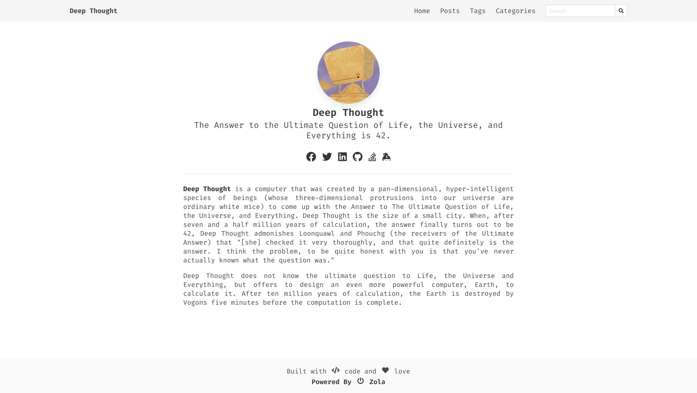

+++
title = "DeepThought"
description = "A simple blog theme focused on writing powered by Bulma and Zola."
template = "theme.html"
date = 2026-10-14T00:40:42+05:30

[taxonomies]
theme-tags = []

[extra]
created = 2026-10-14T00:40:42+05:30
updated = 2026-10-14T00:40:42+05:30
repository = "https://github.com/RatanShreshtha/DeepThought.git"
homepage = "https://github.com/RatanShreshtha/DeepThought"
minimum_version = "0.23.0"
license = "MIT"
demo = "https://deepthought-theme.netlify.app/"

[extra.author]
name = "Ratan Kulshreshtha"
homepage = "https://ratanshreshtha.dev"
+++        

<div align="center">

  
  <h1>DeepThought</h1>
  
  <p>
    A simple blog theme focused on writing powered by Bulma and Zola.
  </p>
  
  
<!-- Badges -->
<p>
  <a href="https://github.com/RatanShreshtha/DeepThought/graphs/contributors">
    
  </a>
  <a href="">
    
  </a>
  <a href="https://github.com/RatanShreshtha/DeepThought/network/members">
    
  </a>
  <a href="https://github.com/RatanShreshtha/DeepThought/stargazers">
    
  </a>
  <a href="https://github.com/RatanShreshtha/DeepThought/issues/">
    
  </a>
  <a href="https://github.com/RatanShreshtha/DeepThought/blob/main/LICENSE">
    
  </a>
</p>
   
<h4>
    <a href="https://github.com/RatanShreshtha/DeepThought/">View Demo</a>
  <span> · </span>
    <a href="https://github.com/RatanShreshtha/DeepThought">Documentation</a>
  <span> · </span>
    <a href="https://github.com/RatanShreshtha/DeepThought/issues/">Report Bug</a>
  <span> · </span>
    <a href="https://github.com/RatanShreshtha/DeepThought/issues/">Request Feature</a>
  </h4>
</div>

<br />

<!-- Table of Contents -->
# :notebook_with_decorative_cover: Table of Contents

- :notebook_with_decorative_cover: Table of Contents
  - :star2: About the Project
    - :camera: Screenshots
    - :space_invader: Tech Stack
    - :dart: Features
  - :toolbox: Getting Started
    - :bangbang: Prerequisites
    - :gear: Installation
      - Upgrading from an earlier version
    - :running: Run Locally
    - :triangular_flag_on_post: Deployment
  - :eyes: Usage
      - Multilingual Navbar
    - KaTeX math formula support
      - Automatic rendering without components
    - Elasticlunr search in other language
  - :wave: Contributing
  - :warning: License
  - :handshake: Contact
  - :gem: Acknowledgements

  

<!-- About the Project -->
## :star2: About the Project


<!-- Screenshots -->
### :camera: Screenshots

<div align="center"> 
  
</div>


<!-- TechStack -->
### :space_invader: Tech Stack


- [Zola](https://www.getzola.org/) - Your one-stop static site engine
- [Bulma](https://bulma.io/) - The modern CSS framework that just works. 

<!-- Features -->
### :dart: Features

- [x] Dark Mode
- [x] Pagination
- [x] Search
- [x] Charts
- [x] Maps
- [x] Diagrams
- [x] Galleria
- [x] Analytics
- [x] Comments
- [x] Categories
- [x] Social Links
- [x] Multilingual Navbar
- [x] Katex

<!-- Getting Started -->
## 	:toolbox: Getting Started

<!-- Prerequisites -->
### :bangbang: Prerequisites

You need static site generator (SSG) [Zola](https://www.getzola.org/documentation/getting-started/installation/) installed in your machine to use this theme follow their guide on [getting started](https://www.getzola.org/documentation/getting-started/overview/).

<!-- Installation -->
### :gear: Installation

Follow zola's guide on [installing a theme](https://www.getzola.org/documentation/themes/installing-and-using-themes/).
Make sure to add `theme = "DeepThought"` to your `config.toml`

**Check zola version (only 0.23.0+)**
Just to double-check to make sure you have the right version. It is not supported to use this theme with a version under 0.23.0.

#### Upgrading from an earlier version

Version 0.23 of Zola changed its template engine (Tera 2) and **removed shortcodes**, so sites using an earlier version of this theme need a few changes when they move to Zola 0.23+.

**`config.toml`**

| Before | Now |
| ------ | --- |
| `generate_feed = true` | `generate_feeds = true` |
| `feed_filename = "rss.xml"` | `feed_filenames = ["rss.xml"]` |
| `highlight_code`, `highlight_theme`, `extra_syntaxes` in `[markdown]` | `theme = "..."` in `[markdown.highlighting]` (theme names changed, e.g. `one-dark` is now `one-dark-pro`) |
| `languages = {code = "fr"}]` | `[languages.fr]` tables (see [Multilingual Navbar |

**Content:** the theme's shortcodes are now components, written with the same tags as HTML:

| Before | Now |
| ------ | --- |
| `…` | `…` |
| `…` | `…` |
| `…` | `…` |
| `…` | `…` |
| `…` | `…` |
| `{{/* katex(body="…") */}}` | `…` |
| `{{/* youtube(id="…") */}}` | `{{/* <youtube id="…" /> */}}` |
| `{{/* vimeo(id="…") */}}` | `{{/* <vimeo id="…" /> */}}` |

Any other Tera syntax in your Markdown must be wrapped in `…`, for example when showing the snippets above in a code block.

**Templates:** if you override DeepThought templates, macros no longer exist. Call the theme's components instead, for example `{{/*<dt.render_tags tags={page.taxonomies.tags} />*/}}` in place of `{{/* macros::render_tags(tags=page.taxonomies.tags) */}}`, and replace your own macros with [components](https://github.com/Keats/tera2/blob/master/MIGRATION.md#components). Tera 2 also errors on undefined variables, so use `a?.b` or `a or b` where a value may be missing.

See the [Zola 0.23 changelog](https://github.com/getzola/zola/blob/master/CHANGELOG.md) and the [Tera 2 migration guide](https://github.com/Keats/tera2/blob/master/MIGRATION.md) for everything else.

<!-- Run Locally -->
### :running: Run Locally

Go into your sites directory and type `zola serve`. You should see your new site at `localhost:1111`.

**NOTE**: you must provide the theme options variables in `config.toml` to serve a functioning site

<!-- Deployment -->
### :triangular_flag_on_post: Deployment

[Zola](https://www.getzola.org) already has great documentation for deploying to [Netlify](https://www.getzola.org/documentation/deployment/netlify/) or [Github Pages](https://www.getzola.org/documentation/deployment/github-pages/). I won't bore you with a regurgitated explanation.

<!-- Usage -->
## :eyes: Usage

Following options are available with the `DeepThought` theme

```toml
# Enable external libraries
[extra]
katex.enabled = true
katex.auto_render = true

chart.enabled = true
mermaid.enabled = true
galleria.enabled = true

navbar_items = [
 { code = "en", nav_items = [
  { url = "$BASE_URL/", name = "Home" },
  { url = "$BASE_URL/posts", name = "Posts" },
  { url = "$BASE_URL/docs", name = "Docs" },
  { url = "$BASE_URL/tags", name = "Tags" },
  { url = "$BASE_URL/categories", name = "Categories" },
 ]},
]

# Add links to favicon, you can use https://realfavicongenerator.net/ to generate favicon for your site
[extra.favicon]
favicon_16x16 = "/icons/favicon-16x16.png"
favicon_32x32 = "/icons/favicon-32x32.png"
apple_touch_icon = "/icons/apple-touch-icon.png"
safari_pinned_tab = "/icons/safari-pinned-tab.svg"
webmanifest = "/icons/site.webmanifest"

# Author details
[extra.author]
name = "DeepThought"
avatar = "/images/avatar.png"

# Social links
[extra.social]
email = "<email_id>"
facebook = "<facebook_username>"
github = "<github_username>"
gitlab = "<gitlab_username>"
keybase = "<keybase_username>"
linkedin = "<linkedin_username>"
stackoverflow = "<stackoverflow_userid>"
twitter = "<twitter_username>"
instagram = "<instagram_username>"
behance = "<behance_username>"
google_scholar = "<googlescholar_userid>"
orcid = "<orcid_userid>"
mastodon_username = "<mastadon_username>"
mastodon_server = "<mastodon_server>" (if not set, defaults to mastodon.social)


# To add google analytics
[extra.analytics]
google = "<your_gtag>"

# To add disqus comments
[extra.commenting]
disqus = "<your_disqus_shortname>"

# To enable mapbox maps
[extra.mapbox]
enabled = true
access_token = "<your_access_token>"
```

#### Multilingual Navbar

If you want to have a multilingual navbar on your blog, you must add each new language as a [languages](https://www.getzola.org/documentation/content/multilingual/#configuration) table in the `config.toml` file.

**NOTE**: Don't add your default language here. Set `build_search_index = true` on each language so search also works on its pages.

```toml
[languages.fr]
build_search_index = true

[languages.es]
build_search_index = true
```

And then create and array of nav item for each language:

**NOTE**: Include your default language in this array

```toml
navbar_items = [
 { code = "en", nav_items = [
  { url = "$BASE_URL/", name = "Home" },
  { url = "$BASE_URL/posts", name = "Posts" },
  { url = "$BASE_URL/docs", name = "Docs" },
  { url = "$BASE_URL/tags", name = "Tags" },
  { url = "$BASE_URL/categories", name = "Categories" },
 ]},
 { code = "fr", nav_items = [
  { url = "$BASE_URL/", name = "Connexion" },
 ]},
 { code = "es", nav_items = [
  { url = "$BASE_URL/", name = "Publicationes" },
  { url = "$BASE_URL/", name = "Registrar" },
 ]}
]
```

en:


fr:


es:


### KaTeX math formula support

This theme contains math formula support using [KaTeX](https://katex.org/),
which can be enabled by setting `katex.enabled = true` in the `extra` section
of `config.toml`.

After enabling this extension, the `katex` component can be used in documents:

- `\KaTeX` to typeset a math formula inlined into a text,
  similar to `$...$` in LaTeX
- `\KaTeX` to typeset a block of math formulas,
  similar to `$$...$$` in LaTeX

#### Automatic rendering without components

Optionally, `\\( \KaTeX \\)` / `$ \KaTeX $` inline and `\\[ \KaTeX \\]` / `$$ \KaTeX $$`
block-style automatic rendering is also supported, if enabled in the config
by setting `katex.auto_render = true`.

### Elasticlunr search in other language

Zola use [Elasticlunr.js](https://github.com/weixsong/elasticlunr.js) to add full-text search feature.
To use languages other than en (English), you need to add some javascript files. See the Zola's issue [#1349](https://github.com/getzola/zola/issues/1349).
By placing the `templates/base.html`on your project and using the `other_lang_search_js` block, you can load the required additional javascript files in the right timing.

e.g. `templates/base.html`

```html
 
<script src="{{/* get_url(path='js/lunr.stemmer.support.js') */}}"></script>
<script src="{{/* get_url(path='js/tinyseg.js') */}}"></script>
<script src="{{/* get_url(path='js/lunr.' ~ lang ~ '.js') */}}"></script>
<script src="{{/* get_url(path='js/search.js') */}}"></script>

```

More detailed explanations are aound in [elasticlunr's documents](https://github.com/weixsong/elasticlunr.js#other-languages-example-in-browser).

<!-- Contributing -->
## :wave: Contributing

<a href="https://github.com/RatanShreshtha/DeepThought/graphs/contributors">
  
</a>


Contributions are what make the open source community such an amazing place to be learn, inspire, and create. Any contributions you make are greatly appreciated.

- Fork the Project
- Create your Feature Branch (git checkout -b feature/AmazingFeature)
- Commit your Changes (git commit -m 'Add some AmazingFeature')
- Push to the Branch (git push origin feature/AmazingFeature)
- Open a Pull Request

<!-- License -->
## :warning: License

Distributed under the MIT License. See  `LICENSE` for more information.


<!-- Contact -->
## :handshake: Contact

Ratan Kulshreshtha - [@RatanShreshtha](https://twitter.com/RatanShreshtha) - ratan.shreshtha[at]gmail.com

Project Link: [https://github.com/RatanShreshtha/DeepThought](https://github.com/RatanShreshtha/DeepThought)


<!-- Acknowledgments -->
## :gem: Acknowledgements

Use this section to mention useful resources and libraries that you have used in your projects.

- [Shields.io](https://shields.io/)
- [Choose an Open Source License](https://choosealicense.com)
- [Awesome README](https://github.com/matiassingers/awesome-readme)
- [Emoji Cheat Sheet](https://github.com/ikatyang/emoji-cheat-sheet/blob/main/README.md#travel--places)
- [Slick Carousel](https://kenwheeler.github.io/slick)
- [Font Awesome](https://fontawesome.com)
- [Unsplash](https://unsplash.com/)

        