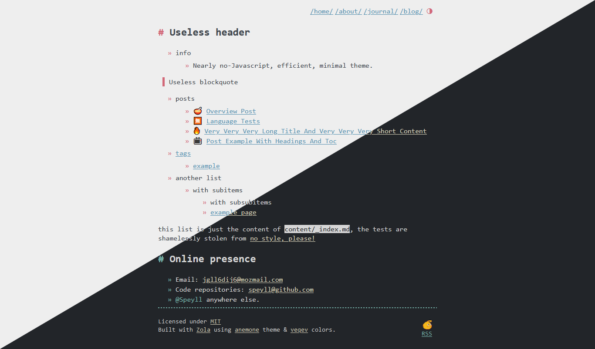

+++
title = "anemone"
description = "A minimalist Zola theme that prioritizes clean CSS and avoids heavy JavaScript. Enjoy a seamless user experience with lightning-fast load times. Let your content take center stage in a clutter-free, elegant design that enhances readability. Responsive and efficient, anemone brings focus to your ideas."
template = "theme.html"
date = 2026-11-01T12:28:00+01:00

[taxonomies]
theme-tags = []

[extra]
created = 2026-11-01T12:28:00+01:00
updated = 2026-11-01T12:28:00+01:00
repository = "https://github.com/Speyll/anemone.git"
homepage = "https://github.com/Speyll/anemone"
minimum_version = "0.23.5"
license = "GPL-3.0"
demo = "https://anemone.pages.dev"

[extra.author]
name = "Speyll"
homepage = "https://speyllsite.pages.dev/"
+++        

# anemone

A minimalist [Zola](https://www.getzola.org) theme that prioritises clean CSS and avoids heavy JavaScript. Content takes centre stage in a clutter-free layout with fast load times, responsive typography, and light/dark colour schemes.

Browse the demo at [anemone.pages.dev](https://anemone.pages.dev/).



## Requirements

- Zola **0.23.5 or newer** (the theme uses Tera 2 components and `text_direction`).

## Installation

1. Clone the theme into your site's `themes` directory:

   ```bash
   cd themes
   git clone https://github.com/Speyll/anemone
   ```

2. Enable it in your `config.toml` (or `zola.toml`):

   ```toml
   theme = "anemone"
   ```

3. Copy the options you need from the [demo `config.toml`](config.toml) and the [content examples](content) in this repository.

## Configuration

### Basic site settings

```toml
base_url = "https://example.com"
title = "My site"
description = "A short description used for meta tags and feeds."
default_language = "en"

theme = "anemone"
generate_feeds = true
generate_sitemap = true

taxonomies = [
  { name = "tags", feed = true, paginate_by = 10 },
]
```

### Interface translations

The theme translates its interface through Zola's translation tables. Missing keys fall back to the default language and then to the built-in English text, so a single-language site does not need a complete table or any table at all.

```toml
# Translations for the default language
[translations]
language_name = "English"
nav_label = "Main navigation"
nav_home = "Home"
nav_about = "About"
nav_blog = "Blog"
language_selector = "Language"
language_homepage = "Homepage"
theme_toggle = "Toggle color theme"
skip_to_content = "Skip to content"
published_on = "Published on"
by_author = "By"
table_of_contents = "Table of contents"
tags = "Tags"
pagination = "Pagination"
previous_page = "Previous page"
next_page = "Next page"
page_of = "{current} of {total}"
all_tags = "All tags"
tagged_with = "Posts tagged “{term}”"
post_count = "{count} posts"
no_tags = "No tags yet."
rss_feed = "RSS feed"
return_home = "Return home"
not_found_title = "404 - Not Found"
not_found_message = "The page you're looking for doesn't exist."
previous_webring = "Previous site in webring"
next_webring = "Next site in webring"
license_prefix = "Except where otherwise noted, content on this site is licensed under the"
license_suffix = "license."
```

`{current}`, `{total}`, `{term}`, and `{count}` are placeholders filled by the templates.

### Navigation

`header_nav` is a list of items. Use `path` for content inside Zola (it is resolved per language), or `url` for an external or hand-written link. `key` looks up a translation; `name` is the fallback label.

```toml
[extra]
header_nav = [
  { path = "@/_index.md", key = "nav_home", name = "Home" },
  { path = "@/about.md", key = "nav_about", name = "About" },
  { path = "@/blog/_index.md", key = "nav_blog", name = "Blog" },
  { url = "https://example.org", name = "Elsewhere" },
]
```

Navigation items are resolved in the current language first. When a translation does not exist, the item stays in the menu and links to the page or section in the default language, with `lang`/`hreflang` naming the destination's real language. Items that exist in no language are hidden rather than linked to a guessed URL. The current page and its parent section are marked as active; fallback links never claim the active state.

### Multilingual sites

Zola's native multilingual system is used throughout: translated URLs, `<html lang>`/`dir`, `hreflang` alternates, per-language feeds and sitemap entries, and `text_direction()` for RTL languages.

```toml
default_language = "en"

[translations]
language_name = "English"
# ...keys...

[languages.fr]
title = "Mon site"
description = "Description française."
generate_feeds = true
taxonomies = [
  { name = "tags", feed = true, paginate_by = 10 },
]

[languages.fr.translations]
language_name = "Français"
nav_home = "Accueil"
nav_about = "À propos"
nav_blog = "Blog"
language_homepage = "Page d'accueil"
# ...other keys...
```

Each non-default language needs its own `taxonomies` and `generate_feeds` setting: Zola does not inherit those from the top-level configuration.

Add translations as sibling files with the language code before `.md`:

```text
content/_index.md
content/_index.fr.md
content/blog/_index.md
content/blog/_index.fr.md
content/blog/post.md
content/blog/post.fr.md
```

The language selector is a single compact dropdown, shown on every multilingual site. The current language is always displayed in the header. Opening it lists the configured languages in a stable order — the default language first, then the others — labelled with each language's `language_name`. When the current page or section has a real translation in a language, the option links to that translation and carries `hreflang`. Otherwise it links to that language's generated homepage, with an accessible `title`/`aria-label` naming it as a homepage; homepage fallbacks deliberately omit `hreflang` because they are not translations of the current page. No URL is concatenated or guessed: a language whose homepage cannot be resolved by `get_section` is omitted. Set `language_name` and `language_homepage` in every translation table so the selector stays readable.

### Other options

```toml
[extra]
author = "Your name"           # also used for article structured data
favicon = "favicon.ico"        # local path or full URL
list_pages = true              # list section pages on the home page
twitter_card = true
display_author = true          # show the author in post headers

# Optional content licence in the footer
footer_content_license = "Creative Commons Attribution 4.0 International"
footer_content_license_link = "https://creativecommons.org/licenses/by/4.0/"
```

Per page:

```toml
+++
title = "A post"
date = 2026-01-02
description = "Shown in meta tags and feeds."

[extra]
author = "Guest author"
display_published = true
toc = true
+++
```

## Content components

Zola 0.23 removed Markdown shortcodes in favour of Tera components. Anemone provides four content components. They run **before** Markdown is rendered, so keep their calls on their own lines and do not indent the surrounding HTML.

### Images

```text
{{/**/}}
```

### YouTube

```text
{{/*<youtube id="VIDEO_ID" title="Video title" class="center" />*/}}
```

Add `autoplay={true}` if needed. The embed uses `youtube-nocookie.com`.

### Webrings

```text
{{/*<webring prev="#" webring="#" webringName="Random Webring" next="#" lang={lang} />*/}}
```

`lang={lang}` makes the accessible previous/next labels follow the content language.

### Mark

```text
Highlighted **text**
```

Because components replace shortcodes, there is no `templates/shortcodes/` directory any more. Define additional components in `templates/components.html` or in files under `templates/`; call them in content with `{{/*<name arg="value" />*/}}`.

## Styling

The theme vendors [suCSS](https://github.com/Speyll/suCSS) so a build never depends on a mutable CDN branch:

- `static/css/sucss.css` — the minified reset and framework, with attribution at the top.
- `static/css/style.css` — Anemone's layout, header, listing, pagination, TOC, and theme-toggle styles.

Both are loaded from the site itself. To customise, override the CSS custom properties or add rules in your own stylesheet after `style.css`. The light theme's accent and link colours are chosen to meet WCAG AA contrast on the page background.

Interactive colours are shared through two framework tokens: `--hover-bg` (the link accent) and `--hover-text` (the page background). Links, navigation, the language dropdown, pagination, tags, and the table of contents all use the same pair on hover and `:focus-visible`. Theme rules only reassign `--link` at rest, so active items keep their accent colour until they are hovered or focused.

## Migrating from earlier releases

1. **Upgrade to Zola 0.23.5+.** Remove `highlight_code`/`highlight_theme` from the `[markdown]` table if present; use `[markdown.highlighting]` instead.
2. **Update navigation** to the `path`/`url` + `key`/`name` schema shown above.
3. **Replace shortcode calls** with the components above (`webring(...)` → `webring` component, and so on).
4. **Add translation tables** if you want translated interface text. They are optional.
5. **Delete template overrides** you copied from old releases (`templates/atom.xml`, `templates/sitemap.xml`, `templates/blog/page.html`, `templates/blog/section.html`). Zola's built-ins handle feeds, sitemaps, and sections correctly for multilingual sites.
6. **Remove `static/click.ogg`** and any custom click-sound code; the theme no longer ships a sound effect.

## Licence

Anemone is available under the [GPL-3.0 licence](LICENSE). The vendored suCSS framework is MIT licensed; see `static/css/sucss-LICENSE.txt`.

        