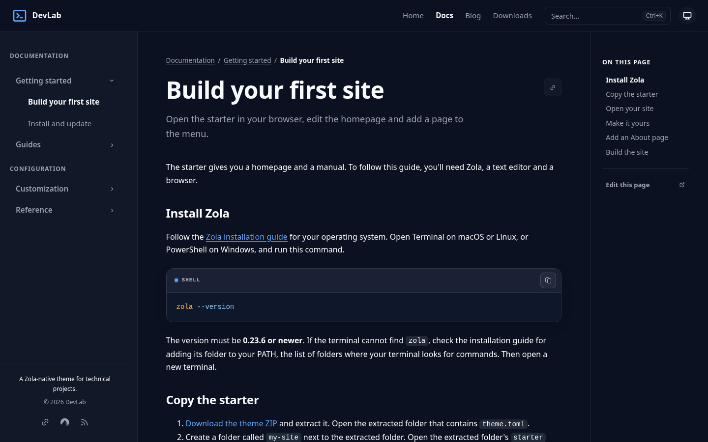

+++
title = "devlab-theme"
description = "A composable Zola theme for product sites, blogs, documentation and books."
template = "theme.html"
date = 2026-11-22T17:02:51+05:00

[taxonomies]
theme-tags = ['documentation', 'blog', 'book', 'product', 'responsive', 'search', 'dark-mode']

[extra]
created = 2026-11-22T17:02:51+05:00
updated = 2026-11-22T17:02:51+05:00
repository = "https://codeberg.org/ripetitor/devlab-theme.git"
homepage = "https://codeberg.org/RiPetitor/devlab-theme"
minimum_version = "0.23.6"
license = "MIT"
demo = "https://ripetitor.codeberg.page/devlab-theme/"

[extra.author]
name = "RiPetitor"
homepage = "https://codeberg.org/RiPetitor"
+++        

[](https://nogithub.codeberg.page)

# DevLab Theme

DevLab is a Zola theme for project sites, blogs, manuals and books. Write your
pages in Markdown and use Tera 2 components when you need a callout, tabs or a
diagram. Zola is a static site generator written in Rust. To build a DevLab
site, all you need is **Zola 0.23.6 or newer**.

[Live demo](https://ripetitor.codeberg.page/devlab-theme/) · [Documentation](https://ripetitor.codeberg.page/devlab-theme/docs/) · [Release notes](https://ripetitor.codeberg.page/devlab-theme/blog/)



## Make your first site

The starter comes with a homepage and a manual. You can open it in your browser
before changing any files.

1. Install Zola and run `zola --version` in a terminal. [Zola installation guide](https://www.getzola.org/documentation/getting-started/installation/)
2. Download and extract DevLab. Copy `zola.toml` and `content/` from `starter/`
   into a new folder called `my-site`. If you use Git, also copy `.gitignore`,
   which may be hidden. [Download DevLab v1.2 (ZIP)](https://codeberg.org/RiPetitor/devlab-theme/archive/v1.2.zip)
3. Create `my-site/themes/` and move the extracted theme folder into it. Name
   that folder `devlab-theme`. Check that `my-site/themes/devlab-theme/theme.toml`
   exists.
4. Open a terminal in `my-site`, run `zola serve` and open the address it prints.
   Edit `content/_index.md` and save it to change the homepage.

The [Quick start](https://ripetitor.codeberg.page/devlab-theme/docs/getting-started/quick-start/)
shows the folder layout and walks through adding an About page and a menu link.
If you already have a Zola site or want to install DevLab as a Git submodule, see
[Install and update](https://ripetitor.codeberg.page/devlab-theme/docs/getting-started/installation/).

## Add to your site

- Give the site a name, logo and colors. [Branding](https://ripetitor.codeberg.page/devlab-theme/docs/customization/branding/)
- Make a landing page, a blog or a manual with a sidebar. [Landing blocks](https://ripetitor.codeberg.page/devlab-theme/docs/reference/landing/) · [Blog](https://ripetitor.codeberg.page/devlab-theme/docs/guides/blog/) · [Manuals and books](https://ripetitor.codeberg.page/devlab-theme/docs/reference/collections/)
- Add callouts, cards, tabs and diagrams to Markdown. [Components](https://ripetitor.codeberg.page/devlab-theme/docs/reference/components/)
- Build and upload your site. [Deployment](https://ripetitor.codeberg.page/devlab-theme/docs/guides/deployment/)

## Development

The repository root is the demo site. Work from the source branch `main`.
The `pages` branch holds the generated demo.

```sh
zola check --skip-external-links
zola build
zola serve
```

The test suite builds small sites with the theme. It requires Python 3.11+
and Node.js on your PATH. Install the schema test dependency in a virtual
environment before running the suite.

```sh
python -m pip install -r tests/requirements.txt
node --version && python -m unittest discover -s tests
```

The browser suite also needs Node.js 22.12+, Playwright's Chromium, Firefox and
WebKit, and `pdftotext` for the Chromium print test. On Debian or Ubuntu,
`pdftotext` comes from `poppler-utils`.

```sh
cd tests/browser
npm ci
npx playwright install --with-deps chromium firefox webkit
npm test
```

To use an existing Chromium binary, set `PLAYWRIGHT_CHROMIUM_EXECUTABLE_PATH`
and run `npm test -- --project=chromium`.

[Release checklist](https://codeberg.org/RiPetitor/devlab-theme/src/branch/main/docs/releasing.md)

## License

DevLab is MIT-licensed. [License](https://codeberg.org/RiPetitor/devlab-theme/src/branch/main/LICENSE) · [Third-party notices](https://codeberg.org/RiPetitor/devlab-theme/src/branch/main/THIRD_PARTY_NOTICES.md)

        