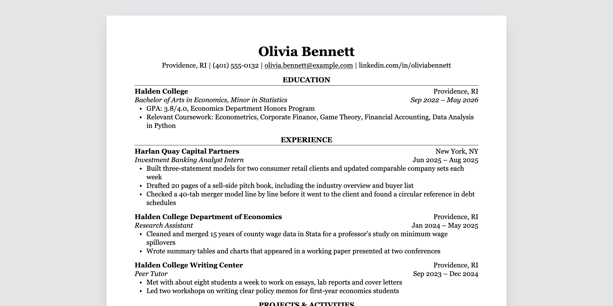

+++
title = "readable-resume"
description = "A one-page resume in one column that prints to a clean PDF on Letter or A4"
template = "theme.html"
date = 2026-10-18T21:12:04+08:00

[taxonomies]
theme-tags = ['resume', 'cv', 'minimal', 'print']

[extra]
created = 2026-10-18T21:12:04+08:00
updated = 2026-10-18T21:12:04+08:00
repository = "https://github.com/supertj/zola-readable-resume.git"
homepage = "https://github.com/supertj/zola-readable-resume"
minimum_version = "0.23.2"
license = "MIT"
demo = "https://readableresume.com/zola-resume-theme"

[extra.author]
name = "Super Lede"
homepage = "https://readableresume.com"
+++        

# Readable Resume for Zola

A one-page resume theme for [Zola](https://www.getzola.org/). You write your
resume in the front matter of one Markdown file and get a web page that prints
to a clean PDF: serif type, centered section headings over a thin rule,
education first. The layout is the Classic template from
[ReadableResume](https://readableresume.com), where the same design is
available for Google Docs and Word.

Demo: https://readableresume.com/zola-resume-theme



Everything sits in one column with no tables, text boxes or icons, and the HTML
follows reading order, so the text comes out of the PDF in the order you read
it. That's the text applicant tracking systems parse.

The page is a single HTML file with the CSS inline. No JavaScript, no web
fonts, nothing else to serve.

## Installation

You need Zola 0.23.2 or later.

Start a site and add the theme as a git submodule:

```sh
zola init my-resume
cd my-resume
git init
git submodule add https://github.com/supertj/zola-readable-resume.git themes/readable-resume
cp themes/readable-resume/content/_index.md content/
```

`zola init` asks a few questions. The defaults are fine; the theme doesn't use
Sass or search.

Then open `zola.toml`. Add this line at the very top, above the first line in
square brackets (if it ends up under `[extra]`, Zola won't see it):

```toml
theme = "readable-resume"
```

and add these settings right below the `[markdown]` and `[extra]` lines that
are already in the file:

```toml
[markdown]
smart_punctuation = true
external_links_no_follow = true

[extra]
resume_paper = "letter"
```

Run `zola serve` and open http://127.0.0.1:1111. The page reloads every time you
save `content/_index.md`.

If you'd rather not use a submodule, clone this repository instead. It's a
working Zola site on its own, so you can edit `content/_index.md` in place and
build it.

## Editing your resume

Everything on the page comes from the front matter of `content/_index.md`,
between the two `+++` lines. It's TOML, so text goes in quotes:

```toml
title = "Olivia Bennett"
description = "Resume of Olivia Bennett, an economics student at Halden College."

[extra]
contact = [
  "Providence, RI",
  "(401) 555-0132",
  "olivia.bennett@example.com",
  "linkedin.com/in/oliviabennett",
]

[[extra.sections]]
title = "Experience"

[[extra.sections.entries]]
company = "Harlan Quay Capital Partners"
location = "New York, NY"
title = "Investment Banking Analyst Intern"
date = "Jun 2025 – Aug 2025"
bullets = [
  "Built three-statement models for two consumer retail clients",
  "Drafted 20 pages of a sell-side pitch book",
]
```

`title` is your name. It goes at the top of the page and in the browser tab.
`description` sets the page's meta description, which search engines may show
in results if you put the page online.

Each `[[extra.sections]]` starts a new section, and sections print in the order
you write them. Section titles are set in capitals for you, so type them however
you like.

Each `[[extra.sections.entries]]` adds an entry to the section above it.
Whether the entry has a `school`, a `company` or a `name` decides its layout:

| Has | Fields | Layout |
|---|---|---|
| `school` | `school`, `location`, `degree`, `date` | School and location on the first line, degree and dates in italics on the second. |
| `company` | `company`, `location`, `title`, `date` | Company and location first, then the job title in italics with the dates. |
| `name` | `name`, `role`, `date` | One line, "Name \| Role" with the dates on the right. For clubs, volunteering and projects. |

The other fields are optional, and `bullets` works on all three. Leave a field
out and it just isn't printed.

A section can also have `lines`, one per line, which is how the skills section
works. A line with a `label` gets the label in bold, followed by a colon:

```toml
[[extra.sections]]
title = "Skills"
lines = [
  { label = "Technical", text = "Excel, PowerPoint, Python (pandas), Stata" },
  { label = "Languages", text = "French (fluent), Spanish (basic)" },
]
```

Or `text`, for a paragraph such as a short summary. Use triple quotes if it
runs over several lines:

```toml
[[extra.sections]]
title = "Summary"
text = "Economics graduate with two years of research experience in labor data."
```

Inline Markdown works in all of these: `**bold**`, `*italic*` and
`[links](https://example.com)`.

In the contact line, email addresses and anything starting with `https://`
become links. To link shorter text, write the item as a table with a `url`:

```toml
contact = [
  "Providence, RI",
  { text = "github.com/oliviabennett", url = "https://github.com/oliviabennett" },
]
```

A `url` has to start with `https://`, `http://`, `mailto:` or `tel:`. The text
of a link like this, and your name in `title`, are printed as typed, without
Markdown.

A misspelled field name in a section, an entry or a contact item stops the
build with a message saying which field and where, rather than quietly leaving
something off your resume.

## Printing to PDF

Open the page in Chrome or Edge, press Ctrl+P (Cmd+P on a Mac), choose
**Save as PDF**, and untick **Headers and footers** under More settings. The
paper size and margins come from the page itself.

Set `resume_paper = "a4"` in `zola.toml` for A4. The margins switch from 0.6 in
to 15 mm, the same as the Google Docs original.

Firefox and Safari print it too. Check that the paper size in their print
dialog matches, since they don't always pick it up from the page.

## Configuration

All of these go in your `zola.toml`.

| Setting | Default | What it does |
|---|---|---|
| `resume_paper` under `[extra]` | `"letter"` | `"letter"` or `"a4"`. Sets the page size and margins for printing, and the size of the sheet on screen. |
| `smart_punctuation` under `[markdown]` | `false` | Turns straight quotes and apostrophes into curly ones and `--` into an en dash, like the original. |
| `external_links_no_follow` under `[markdown]` | `false` | Adds `rel="nofollow"` to links to other sites. |

Links in the contact line follow the same `[markdown]` link settings as the
rest of the page, including `external_links_target_blank`,
`external_links_no_referrer` and `external_links_class`. Email and phone links
are left alone.

## Changing the design

The theme has two templates:

- `templates/partials/style.html` has all the CSS. Font sizes are in points so
  the printed page matches the original.
- `templates/index.html` builds the page from the front matter.

To change the styling, copy `templates/partials/style.html` into the same path
in your own site and edit it there. Zola uses your copy instead of the theme's.

To add something without copying the whole page, create `templates/index.html`
in your site, make it extend `readable-resume/templates/index.html`, and fill in
one of these blocks:

- `head`: extra tags in `<head>`, such as another stylesheet. It holds the
  theme's CSS, so call `super()` to keep it.
- `before_resume` and `after_resume`: content above or below the sheet. Hide
  it in print with `@media print` if it shouldn't end up in the PDF.
- `title`: the text in the browser tab.

## Fonts

The design uses Georgia, which comes with Windows and macOS, so there's nothing
to install on those systems. Elsewhere, such as Linux or Android, the browser
falls back to Gelasio if you have it installed (it's free on Google Fonts and
drawn to Georgia's proportions), then to Times New Roman or the default serif.
A different font can change the line breaks, so print from a computer that has
Georgia if the page is close to full.

## Putting it online

Set `base_url` in `zola.toml` to the address the site will live at, then run
`zola build`. The page ends up in `public/index.html`. With the default
settings Zola also writes `robots.txt`, `sitemap.xml` and `404.html` there.

The page shows everything in your contact line, phone number included, so check
that before you publish it.

## License

MIT. The person, schools and companies in the sample are made up.

        